<h1 align="center"><b>Dimitrios Papakonstantinou</b></h1>

  

## About me

- Aspiring Data Engineer
- Hobbyist Compiler Engineer
- I am studying Informatics at the [University of Western Machedonia](https://www.uowm.gr/).

## Socials

# Tech Stack
                

